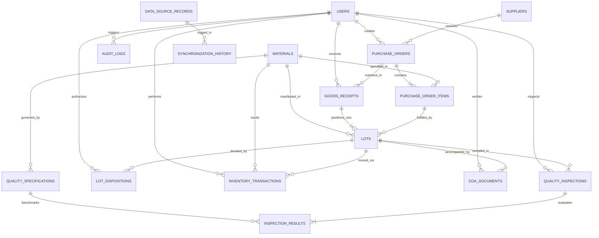

# Entity Relationships & Architecture Model

## 1. Overview
The Raw Material Receiving Yard and Quality Inspection Management System establishes an unbroken chain of custody from initial Purchase Order issuance to physical gate arrival, strict lot quarantine, laboratory testing, authorized disposition sign-off, and final production release.

---

## 2. Mermaid Entity-Relationship Diagram

---

## 3. Key Relationships and Cardinalities

### A. Procurement & Receiving Hierarchy
- **Supplier (1) to Purchase Orders (0..*)**: A supplier can hold multiple purchase orders over time.
- **Purchase Order (1) to Purchase Order Items (1..*)**: Each PO has at least one line item specifying material, quantity, and tolerance.
- **Purchase Order (1) to Goods Receipts (0..*)**: A PO may be fulfilled through single or split truck deliveries (partial shipments).
- **Goods Receipt (1) to Lots (1..*)**: A physical truck arrival can yield one or more discrete material lots.

### B. Quarantine & Lot Tracking Hierarchy
- **Purchase Order Item (1) to Lots (0..*)**: Multiple deliveries/lots accumulate against a single PO line item.
- **Lot (1) to CoA Documents (0..*)**: A lot can have vendor Certificates of Analysis attached, verified before or during inspection.
- **Lot (1) to Quality Inspections (0..*)**: A lot may undergo initial testing and, if necessary, re-sampling or secondary inspection.
- **Quality Inspection (1) to Inspection Results (1..*)**: An inspection records individual measurements across all active specifications for that material.
- **Quality Specification (1) to Inspection Results (0..*)**: Specifications benchmark measurements against minimum/maximum thresholds.

### C. Quality Disposition & Traceable Inventory Release
- **Lot (1) to Lot Dispositions (0..*)**: Authorized quality decision recording approval, partial acceptance, or rejection.
- **Lot (1) to Inventory Transactions (1..*)**: All quantity movements (e.g. `RECEIPT_TO_QUARANTINE`, `QUARANTINE_TO_APPROVED`, `APPROVED_TO_PRODUCTION`) are immutably logged.

---

## 4. Foreign Key Constraints & Integrity Rules

1. **Delete Protection (`ON DELETE RESTRICT`)**:
   - `suppliers` cannot be deleted if referenced in `purchase_orders`.
   - `materials` cannot be deleted if referenced in `purchase_order_items`, `lots`, or `inventory_transactions`.
   - `lots` cannot be deleted if any `lot_dispositions` or `inventory_transactions` exist.
2. **Cascading Child Records (`ON DELETE CASCADE`)**:
   - Deleting a `purchase_order` cascade-deletes its `purchase_order_items` (only allowed in `DRAFT` status).
   - Deleting a `quality_inspection` cascade-deletes its `inspection_results`.
3. **Audit Immutability**:
   - `audit_logs` and `inventory_transactions` have no foreign key cascaded deletions; once recorded, transactions are permanent and immutable.

---

## 5. Domain Invariants Enforced by Architecture

| Invariant Rule | Enforcement Mechanism |
| :--- | :--- |
| **Strict Initial Quarantine** | Newly created `lots` default to `status = 'QUARANTINED'` and `quarantined_quantity = received_quantity`. |
| **Conservation of Mass** | Database constraint checks `quarantined_quantity + approved_quantity + rejected_quantity = received_quantity`. |
| **Production Release Gate** | Only lots with `status IN ('FULLY_APPROVED', 'PARTIALLY_APPROVED')` can emit `APPROVED_TO_PRODUCTION` inventory transactions. Released quantity cannot exceed `approved_quantity`. |
| **Inclusive Bounds** | Tolerance (e.g., ±5.0%) and test limits (`min_value <= measured <= max_value`) are evaluated inclusively. |
| **Mandatory Test Failure Block** | If any mandatory specification has `is_compliant = false`, the system blocks `APPROVE_FULL` and flags the lot for rejection or quarantine hold. |

