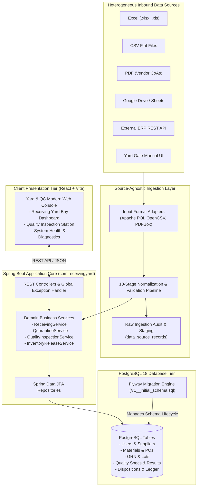
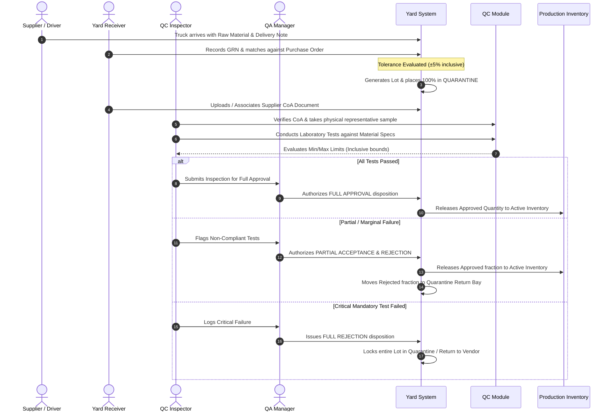

# System Architecture & Technical Specification

## 1. Executive Architecture Summary

The **Raw Material Receiving Yard & Quality Inspection Management System** is an enterprise-grade manufacturing execution subsystem engineered to govern raw material intake, purchase order reconciliation, quarantine custody, quality verification, disposition decision-making, and production release.

### Core Architectural Pillars
- **Zero-Trust Quarantine by Default**: Material cannot reach production inventory without passing verified quality checks and authorized sign-off.
- **Source-Agnostic Ingestion**: Hexagonal adapter architecture decoupling heterogeneous inbound formats (Excel, CSV, PDF, Google Drive, ERP APIs) from internal domain logic.
- **Strict Conservation of Material**: Rigorous ledger accounting guaranteeing that received quantities equal the sum of quarantined, approved, and rejected fractions.
- **Auditable Traceability**: Every state transition, inspection result, and inventory movement is permanently recorded with user identity, timestamp, and immutable transaction logs.

---

## 2. Technology Stack

| Layer | Technology | Key Capabilities & Rationale |
| :--- | :--- | :--- |
| **Frontend** | React 18 / Vite 5 | High-performance SPA, modular component layout, responsive yard dashboards, Tailwind styling. |
| **Backend** | Java 21 / Spring Boot 3.3.5 | Robust layered modular architecture, enterprise stability, native REST endpoints, declarative transactions. |
| **Database** | PostgreSQL 18 | Strong ACID compliance, relational integrity constraints, native JSONB support for variable ingestion payloads. |
| **Migration** | Flyway 10.x | Code-driven database versioning, automated schema evolution, repeatable deployments. |
| **API Protocol** | RESTful JSON over HTTP | Standardized HTTP status codes, uniform error envelopes, complete decoupling of UI and API. |
| **Testing** | JUnit 5, Mockito, Postman | Automated unit/integration tests and standardized Postman collections for endpoint validation. |

---

## 3. High-Level System Architecture Diagram



---

## 4. Source-Agnostic Ingestion Pipeline (10 Stages)

```mermaid
flowchart LR
    S1["1. Source Identification"] --> S2["2. File / Stream Retrieval"]
    S2 --> S3["3. MIME & Type Detection"]
    S3 --> S4["4. Parsing & Extraction"]
    S4 --> S5["5. Canonical Field Mapping"]
    S5 --> S6["6. Business Validation"]
    S6 --> S7["7. Duplicate & Hash Check"]
    S7 --> S8["8. Entity Relationship Matching"]
    S8 --> S9["9. Database Persistence"]
    S9 --> S10["10. Audit & Error Reporting"]
```



### Description of Pipeline Stages
1. **Source Identification**: Classifies origin (Excel upload, CSV file drop, PDF CoA attachment, ERP webhook, Google Drive connector).
2. **File / Stream Retrieval**: Securely ingests file byte stream and computes cryptographic SHA-256 hash.
3. **MIME & Type Detection**: Inspects magic bytes and MIME type to prevent malicious or malformed payloads.
4. **Parsing & Extraction**: Format-specific parser extracts raw tabular rows or key-value document data.
5. **Canonical Field Mapping**: Maps disparate vendor column names (e.g. `PO#`, `Order_Num`, `Purchasing_Doc`) to unified domain model (`poNumber`).
6. **Business Validation**: Validates constraints (quantities $> 0$, units match allowed catalog, dates are valid).
7. **Duplicate Detection**: Verifies checksum and business unique keys to prevent double-processing.
8. **Relationship Matching**: Matches incoming records to existing Master Data (Suppliers, Materials, Active POs).
9. **Database Persistence**: Atomically persists valid records within transactional boundaries.
10. **Audit & Error Reporting**: Stores full execution metrics into `data_source_records` and `synchronization_history`. Invalid rows are captured with line numbers and failure reasons for user review.

---

## 5. End-to-End Manufacturing Yard & QC Lifecycle



---

## 6. Backend Modular Structure (`com.receivingyard`)

```
backend/src/main/java/com/receivingyard/
├── config/             # CORS, Security, Database, OpenAPI, Jackson configurations
├── controller/         # REST Controllers (thin web layer, DTO in/out)
├── service/            # Core business workflows, transaction boundaries
│   └── impl/           # Service implementation classes
├── repository/         # Spring Data JPA repositories with query methods
├── entity/             # JPA entity models mapped to PostgreSQL schema
├── dto/                # Request and Response Data Transfer Objects
├── enums/              # Domain enumerations (LotStatus, Role, InspectionStatus)
├── exception/          # Custom exceptions and GlobalExceptionHandler (@RestControllerAdvice)
├── integration/        # Source-independent adapters (Excel, CSV, PDF, ERP)
└── validation/         # Custom business validators (ToleranceValidator, SpecLimits)
```

### Architectural Principles
- **Separation of Concerns**: Controllers delegate immediately to service interfaces. No database entities are exposed over the wire.
- **Global Error Standard**: All uncaught errors produce a standardized JSON payload:
  ```json
  {
    "timestamp": "2026-10-31T16:30:00Z",
    "status": 400,
    "error": "Bad Request",
    "message": "Received quantity exceeds acceptable tolerance bracket [95.0, 105.0]",
    "path": "/api/v1/receiving/grn"
  }
  ```
- **Environment Driven**: Zero hardcoded credentials; all connection strings, ports, and tolerances originate from environment variables with sensible local defaults.

---

## 7. Frontend Modular Structure (`frontend/src`)

```
frontend/src/
├── components/         # Reusable UI widgets (StatusBadge, Modal, MetricCard)
├── layouts/            # Navigation layout with header, sidebar, and status indicator
├── pages/              # View pages (Dashboard, ReceivingYard, QualityInspection, Settings)
├── services/           # Axios/Fetch API client wrappers communicating with backend
├── hooks/              # Custom React hooks (useApi, useHealthCheck)
├── utils/              # Formatting helpers (formatDate, formatQuantity, toleranceColor)
├── App.jsx             # Main application component & routing
└── main.jsx            # React root bootstrap
```

### Key UI Capabilities
- Live **Backend & Database Health Connectivity Indicator** on the header bar.
- Interactive **Receiving Yard Metrics** (Quarantine, Approved, Released, Rejected counts).
- Real-time **Quantity Tolerance Visualizer** showing whether received shipments fall within ±5% boundaries.
- Traceability view linking GRN $\rightarrow$ Lot $\rightarrow$ CoA $\rightarrow$ Inspection $\rightarrow$ Release.

